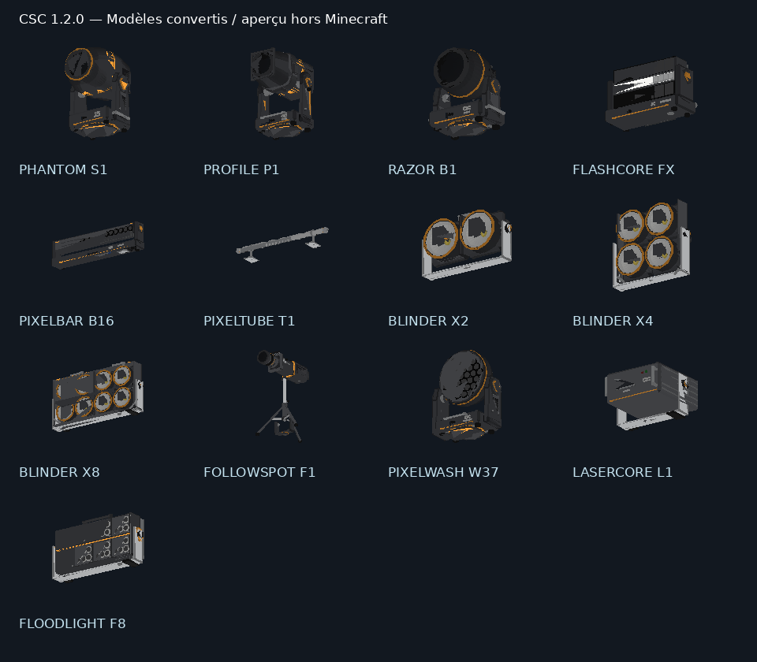

# CSC 1.2.0 — Intégration des nouveaux projecteurs : rapport de développement

Date : 10 novembre 2026. Cible : Minecraft 1.20.1, Forge 47.4.28, Java 17.

## État réel de la livraison

**Cette livraison n’est pas une intégration de production terminée.** Elle contient une implémentation source substantielle des 13 appareils, leurs modèles convertis et leurs profils externes, avec des tests hors jeu réussis. La compilation Forge complète, l’utilisation dans Minecraft, le multijoueur, les importations dans les consoles et les performances graphiques ne sont pas validés. Certaines fonctions exigées restent incomplètes, détaillées ci-dessous. Aucun JAR nouvellement compilé n’est livré.

Les deux archives d’origine sont restées intactes. Les 13 fichiers Blender originaux et leur documentation sont aussi copiés dans `source-assets/new_lights/`, sans réenregistrement ; leurs SHA-256 sont vérifiés par le contrôle des ressources.

## Audit de l’architecture

| Domaine | Architecture identifiée | Intervention |
|---|---|---|
| Registre | `StageContent`, `FixtureProfile`, `StageCatalog`, type partagé `FIXTURE_ENTITY` | 13 profils et blocs ajoutés au registre et au catalogue existants |
| DMX | `DmxMode`, `DmxDecode`, `DmxData`, `AutoPatch` | Cache par identité, 17 types, canaux RGBW supplémentaires, validation de fin d’univers |
| Modes | Full, Compact, Ultra Compact, Virtual Matrix | Même système conservé ; aucune nouvelle personnalité |
| Rendu | `FixtureRenderer`, `FixtureMeshes`, `OpticalProfile`, `VolumeLights`, `BeamOptics` | Modèles CSC natifs, familles optiques, masques communs étendus |
| Faisceaux / occlusion | `BeamShadows`, shaders de volume et de projection, rayons de surfaces | Réutilisés ; aucune nouvelle boucle d’éclairage indépendante |
| Modèles | JSON par parties base/yoke/head et trois LOD | Nouveau backend Blender de `export_fixtures.py`, géométrie originale évaluée |
| AutoShow | `AutoShow`, `LiveAutoShow`, effets et presets existants | Sélection des familles par capacités ; motifs laser ; attributs non pris en charge écartés des looks |
| Réseau | `ExternalControl`, `DmxPackets`, `DmxMerge`, `ArtNetSettings` | Art-Net et sACN existaient ; pas de réécriture des récepteurs |
| Persistance / synchronisation | `Show`, `Look`, commandes, `LightNet`, tags et paquets BE | Masque extensible d’attributs, lecture des anciennes données, orientation manuelle synchronisée via le BE existant |
| Interface | `LumicoreScreen` | Sélecteur des 17 types paginé ; pages des fonctions optiques supplémentaires |
| Exportations | `DumpModes`, `ma2_profiles.py`, `build_external_assets.py`, `dmx_charts.py`, `build.sh` | Chaîne existante étendue, tables Java toujours source des canaux |

### Modèles et matériaux

Les fichiers utilisent Blender 5.3 et une compression Zstandard ; Blender 4.3 ne les ouvrait pas. La conversion a été exécutée avec Blender 5.3.0, sans sauvegarder les `.blend`. Elle conserve les triangles, les proportions, les pièces, les positions des pivots et les trois LOD fournis. Les géométries de studio sont exclues par la hiérarchie ROOT.

Les matériaux deviennent leurs couleurs Principled converties en sRGB, avec l’éclairage et la palette du moteur existant. Les propriétés PBR de verre, métal et rugosité ne sont pas reproduites intégralement. Les repères internes de préparation fournis sont des objets vides, et non des mécanismes intérieurs modélisés. Les rangées manuelles X4 sont exportées à leur pose de repos.

Total pour les 13 appareils : **109 354 triangles LOD0 ; 23 464 LOD1 ; 3 685 LOD2**. Aucun modèle générique n’a été substitué.



## Appareils et empreintes DMX

Les valeurs ci-dessous viennent de `DumpModes.java`, donc des tables effectivement utilisées par le décodage Java. Les quatre appareils historiques gardent exactement leurs canaux, leur ordre, leurs défauts et leurs instances : VORTEX 18/14/4 ; LUMORA W7 70/12/4 ; LUMORA W19 124/12/4 ; PULSESTRIKE 82/10/4.

| Projecteur | Full | Compact | Ultra Compact | Virtual Matrix | Fonctions implémentées dans les sources |
|---|---:|---:|---:|---:|---|
| CSC PHANTOM S1 | 28 | 13 | 4 | 0 | PAN/TILT 16 bits, CMY, shutter, deux roues de gobos rotatifs, animation, prismes, iris, zoom, focus. |
| CSC PROFILE P1 | 27 | 13 | 4 | 0 | PAN/TILT, CMY/RGB, gobos, iris, zoom/focus, prisme, quatre couteaux et rotation du cadre dans le masque GLSL. |
| CSC RAZOR B1 | 18 | 11 | 4 | 0 | PAN/TILT, faisceau étroit, roue de couleurs, gobos, prisme huit facettes, frost et focus. |
| CSC FLASHCORE FX | 60 | 10 | 3 | 0 | 12 zones RGB + 12 segments blancs indépendants, tilt, dimmer et strobe. |
| CSC PIXELBAR B16 | 75 | 9 | 3 | 0 | 16 pixels RGBW indépendants, tilt, zoom, effets de pixels existants. |
| CSC PIXELTUBE T1 | 55 | 6 | 2 | 0 | 16 pixels RGB, CTO, strobe, diffuseur conservé, orientation manuelle commune. |
| CSC BLINDER X2 | 7 | 4 | 2 | 0 | 2 niveaux de cellules indépendants, dimmer, CTO, strobe, orientation manuelle commune. |
| CSC BLINDER X4 | 9 | 4 | 2 | 0 | 4 niveaux de cellules indépendants, dimmer, CTO, strobe, orientation manuelle commune. |
| CSC BLINDER X8 | 13 | 4 | 2 | 0 | 8 niveaux de cellules indépendants, dimmer, CTO, strobe, effets de pixels et orientation manuelle commune. |
| CSC FOLLOWSPOT F1 | 11 | 7 | 2 | 0 | Douser, iris, zoom/focus, filtres via palette CSC, PAN/TILT manuels, aucun moteur DMX fictif. |
| CSC PIXELWASH W37 | 162 | 12 | 4 | 0 | 37 pixels RGBW indépendants, PAN/TILT, zoom, anneaux et diffusion Wash du moteur existant. |
| CSC LASERCORE L1 | 10 | 5 | 2 | 0 | Simulation RGB : point, éventail, cercle, croix et carré, vitesse/taille, rotation, douser. |
| CSC FLOODLIGHT F8 | 40 | 7 | 2 | 0 | 8 zones RGBW indépendantes, CTO, strobe, effets de pixels, distribution architecturale large. |

Les blinders blancs n’exposent pas de faux canaux RGB. Leur Ultra Compact contient dimmer et strobe. Les modes Full à pixels disposent des composantes individuelles réelles : RGBW pour B16/W37/F8, RGB pour T1 et les 12 cellules FLASHCORE, niveaux indépendants pour les segments blancs/blinders. La fusion HTP avec la couleur globale suit la logique CSC existante ; mettre la couleur globale à zéro permet de dessiner uniquement avec les pixels. L’énergie agrégée des nouveaux appareils suit la proportion de cellules allumées.

Chaque appareil a été testé hors jeu pour l’absence de collision de cache, son empreinte, son décodage dans les trois modes conventionnels, Virtual Matrix, les attributs normalisés et le passage des paquets jusqu’au décodeur. Cela ne démontre pas son fonctionnement dans Minecraft. Le fichier `status-per-fixture.json` donne, pour chacun des 13 appareils, les statuts distincts des modèles, animations, quatre modes, protocoles, rendu, AutoShow, profils, multijoueur et performances.

## Extensions optiques

- CMY soustractif et roue de couleurs filtrent réellement la couleur émise.
- Douser/shutter agissent sur le dimmer final commun aux lentilles, au volume et aux surfaces.
- Les quatre couteaux et la rotation du cadre agissent dans le masque commun GLSL et son équivalent Java, et non sur une texture décorative.
- RAZOR utilise huit images de prisme. PHANTOM a une seconde roue de gobos rotatifs analytique, une animation et deux commandes de prisme. Les images GDTF de cette seconde roue sont exportées depuis le code optique Java.
- Le laser utilise cinq motifs graphiques animés dans le moteur existant, sans commande de matériel laser.
- Le frost élargit et adoucit le faisceau ; les familles Spot, Wash et panneaux utilisent leurs distributions existantes adaptées.
- La porte strobe est partagée : un dimmer à zéro reste strictement éteint, même pendant la phase active d’un flash.

Les capacités d’occlusion, de brouillard, de limitation des faisceaux, de cache GPU et de LOD sont celles du moteur CSC existant. Les changements ne constituent pas une preuve que les anciens défauts de truss, de gobos ou de compatibilité avec des shaders tiers ont disparu en jeu.

## Réseau et adresses

Art-Net : Port-Address 0 conserve l’univers CSC 0, sans décalage automatique. Les sélections et mappings existants restent utilisés. sACN : univers 1 à 63999, identité avec l’univers CSC ; l’univers 0 est rejeté et n’est pas joint en multicast. Le patch était limité à 64 : il a été étendu à 63999 dans la validation et les contrôles concernés. Le nombre d’univers simultanés enregistrables reste soumis au budget existant du format de show ; il ne faut pas confondre numéro d’univers et nombre d’univers actifs.

Les changements de patch dépassant l’adresse 512 sont refusés avant mutation. Les priorités, CID, séquences et pertes de sources utilisent `DmxMerge` existant. Les tests de paquets se font en mémoire ; aucune réception UDP provenant d’une vraie console ni jonction multicast réelle n’a été démontrée.

## Sauvegardes et commandes

Les nouveaux attributs dépassent la taille de l’ancien masque. Les nouveaux looks portent un marqueur explicite et un masque de 64 bits. Le format Show passe à **3** ; les anciens formats 1/2 continuent à être lus. Un fichier binaire écrit avec le code original fourni, au format 2, est livré comme test de régression et a été relu avec ses quatre types et ses valeurs de cues. Le retour d’une sauvegarde au format 3 vers le mod original n’est pas pris en charge. La compatibilité d’un monde Minecraft complet doit encore être testée.

Les appareils fixes ne reçoivent pas de canaux de moteurs fictifs. Une orientation manuelle commune est ajoutée dans le BE existant : accroupi + clic droit à main vide change le tilt par pas de 15°. Sur le FOLLOWSPOT, un clic dans la partie basse règle le pan ; la partie haute règle le tilt. Cette interaction et sa réplication sont implémentées mais non testées en jeu. Les deux rangées du X4 ne sont pas réglables séparément.

## Profils externes

17 GDTF pour grandMA3, 51 XML grandMA2, 51 XML dot2 et 17 QXF QLC+ sont générés. Les trois modes conventionnels sont inclus ; Virtual Matrix n’a pas d’empreinte individuelle et n’est pas exporté comme une personnalité conventionnelle. Les modèles glTF/OBJ/3DS et les tables de canaux accompagnent les profils.

Les fichiers ont été générés, leur XML lu, les géométries/roues référencées contrôlées et les canaux/defaults/ranges MA comparés aux tables du jeu. **Aucune importation dans grandMA2, dot2, grandMA3 ou QLC+ n’a été effectuée ; aucune conformité complète XSD GDTF ni sortie DMX réelle de ces logiciels n’est revendiquée.** Les attributs étendus, notamment laser/animation/shutter et les noms MA, doivent être vérifiés dans les versions cibles.

Références consultées pour les attributs : [MA Lighting — Fixture Types](https://help.malighting.com/grandMA2/en/help/ma_3d/key_fixture-types.html) ; [GDTF 1.2 — Annex](https://gdtf-development.com/help/developers/gdtf_1_2/annex/index.html). La compatibilité d’import ne se déduit pas de ces références.

## Tests réellement exécutés

| Suite | Résultat final | Portée |
|---|---|---|
| Moteur lumière historique | passed 156, failed 0 | Moteur, commandes, effets, AutoShow, budgets théoriques |
| Contrôle et exportations | passed 148, failed 0 ; passed 27, failed 0 ; passed 756, failed 0 | Paquets, fusion, modes, fichiers de show et exportations |
| 17 types et nouveaux contrôles | passed 2812, failed 0 | Canaux, pixels RGBW, flux, matrice, adresses, sauvegarde originale, AutoShow |
| Optique historique et distributions | passed 19, failed 0 | Énergie des distributions et comparaison GLSL/Java |
| Nouveaux masques optiques | passed 26 x 4096 points, failed 0; worst relative error 1.080930233001709E-4 | Couteaux, prismes, seconde roue/animation, laser, comparaison GLSL/Java |
| Audio | Script complet terminé avec code de sortie 0 | Décodage, seek, mixer, limiter, playlists, gapless, DSP, EQ, réverbération, acoustique |
| Ressources | 13 appareils contrôlés | SHA-256 Blender, 3 LOD, comptage des cellules, ressources, XML et facettes |
| Syntaxe Java | Aucune erreur de parsing détectée | Analyse syntaxique ; ne remplace pas une compilation Forge |

Les comparaisons optiques emploient le shader GLSL livré et Mesa llvmpipe hors écran. La suite nouvelle couvre 26 cas de 4096 points chacun, avec une erreur relative maximale d’environ 0,000108 entre Java et GLSL. Les logs complets sont sous `validation/new_lights/`.

### Mesures CPU

```text
CPU mixed rig 50 fixtures: 104.4 us/evaluation (no GPU or FPS measurement)
CPU mixed rig 100 fixtures: 67.0 us/evaluation (no GPU or FPS measurement)
CPU mixed rig 200 fixtures: 240.3 us/evaluation (no GPU or FPS measurement)
```

Ces mesures évaluent uniquement le moteur Java sur une machine partagée, après échauffement ; elles ne mesurent ni le rendu, ni les FPS, ni un serveur Minecraft. Aucun benchmark graphique 50/100/200 projecteurs n’a été réalisé.

## Compilation

La dépendance Forge est portée à `net.minecraftforge:forge:1.20.1-47.4.28`. Le JDK 17 et Gradle 8.8 ont été préparés pour les vérifications. La compilation complète a été tentée avec le wrapper puis avec Gradle local. Elle échoue pendant la résolution du plugin **ForgeGradle 6.0.36**, avant `compileJava` ; la récupération de son POM depuis `maven.minecraftforge.net` renvoie HTTP 403 dans cet environnement.

Voir `forge-build-local.log`, `forge-build-ipv4.log` et `forge-repository.log`. **Les classes Minecraft/client n’ont donc pas été vérifiées par le compilateur Forge. Aucun JAR final n’a été produit.** Les compilations réussies des suites Java concernent le noyau sans dépendances Minecraft. Les fichiers historiques de compilation de l’archive originale ne constituent pas des résultats de cette modification.

## Exigences restant à terminer ou valider

1. Compiler le projet complet, corriger d’éventuelles erreurs de types/API puis lancer Forge 47.4.28 avec les 17 appareils.
2. Terminer le réglage indépendant des rangées du BLINDER X4 et leur influence optique.
3. Ajouter et tester la simulation thermique tungstène automatique du BLINDER X2 si cette fonction préparée dans la documentation Blender est maintenue.
4. Affiner la fidélité des six filtres physiques FOLLOWSPOT, la combinaison des deux prismes PHANTOM et les sorties scanner LASERCORE ; les approximations actuelles sont décrites dans les statuts par appareil.
5. Vérifier les animations/pivots/montages, les lentilles éteintes/allumées, gobos, prismes, couteaux, pixels, brouillard et occlusion dans de vrais décors Minecraft.
6. Tester Shimmer, Theatrical ExtraLights et les chemins de dégradation lorsque les shaders avancés sont indisponibles. Les masques avancés ne sont pas tous reproduits par les anciens chemins de repli.
7. Importer chaque profil dans les quatre logiciels, vérifier attributs, patch, sortie DMX, réception et rendu Minecraft.
8. Tester serveur dédié, clients multiples, reconnexion, changements de chunks, sauvegarde/redémarrage et anciens mondes.
9. Mesurer FPS/GPU et consommation mémoire à 50/100/200 projecteurs et ajuster les budgets.

Ces points empêchent de considérer le cahier des charges entièrement satisfait. Aucune validation en jeu, stabilité de production ou absence de régression globale n’est revendiquée.

## Reproduction et fichiers

Avec JDK 17, Python/Pillow, GCC/Mesa pour les shaders et Blender 5.3 :

```sh
python3 tools/lightshow/export_fixtures.py --new-lights /chemin/vers/blender source-assets/new_lights/Blender common/src/main/resources/assets/concertstage
sh tools/external/build.sh
sh tools/lightshow_tests/run.sh
sh tools/lightshow_tests/run_external.sh
sh tools/lightshow_tests/run_new_fixtures.sh
sh tools/lightshow_tests/run_new_optics.sh
python3 tools/lightshow_tests/check_new_assets.py
sh tools/audio_tests/run.sh
cd forge
./gradlew --no-daemon build
```

`tools/lightshow_tests/run_optics.sh` exécute aussi les contrôles historiques ; le comparateur GLSL requiert un harness compilé, sélectionnable avec la propriété Java `harness`.

Classes nouvelles : `ProfessionalOptics`, `DumpSecondaryGobos` et les suites `NewFixturesTest`/`NewOpticsTest`. Le backend Blender et les contrôles de ressources sont ajoutés aux outils existants. Les autres modifications étendent les classes listées dans l’audit. `changed-files.json` donne la liste détaillée des fichiers créés/modifiés ; `status-per-fixture.json` fournit les statuts complets par projecteur. La documentation DMX détaillée est `Documentation/External_Control/DMX_CHARTS.md`.
